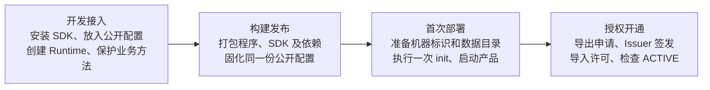

# SDK 0.7.1：开发接入、构建发布、首次部署与授权开通

本文面向把授权功能接入自己产品的开发者。按四个阶段操作；Python 和 Java 选择自己的语言即可，不要求同时接入，也不依赖 ICP Diag 的源码或部署脚本。



| 阶段 | 谁执行、在哪里执行 | 做完得到什么 |
| --- | --- | --- |
| 开发接入 | 产品开发者，在产品工程目录 | 已接入 SDK 的代码，含状态查询、业务核验和可选管理接口 |
| 构建发布 | 产品制作方，在开发机／CI／镜像构建环境 | SDK、依赖和公开配置齐全的产品交付包或镜像 |
| 首次部署 | 安装人员，在客户机器；开发联调时可用本机独立测试目录 | SDK 生成的安装资料，启动后通常为 `UNLICENSED` |
| 授权开通 | 安装人员与签发人员配合 | 导入商业许可后为 `ACTIVE`，受保护业务可以执行 |

**开发者读完开发接入，再准备测试交付包，按后两个阶段在自己的测试目录联调；不需要先找到真实客户。** 日常启动只运行产品，保留原授权数据。`init` 是单独的首次安装操作，不放入每次业务启动中。

全文用 `gateway` 表示服务 ID，必须替换为 Issuer“SDK 接入配置”中实际登记的服务，例如 `metor`。一个进程只维护一个服务的 Runtime；同一配置有多个服务时，明确指定本进程使用哪一个。

## 一、开发接入：先让自己的程序会使用 SDK

### 1. 下载 SDK 和本产品的公开配置

在**产品工程根目录**操作，下面称为 `my-product/`。它是你的业务工程，不是 SDK 仓库。准备下载目录：

```bash
mkdir -p downloads vendor
```

从本产品的 Issuer 解锁后，进入“SDK 接入配置”，下载 `license-product.json`，先保存到工程的 `downloads/license-product.json`。配置已经包含产品、服务、域、前缀与可信公钥，不需要手填这些字段。

配置是公开的，但决定程序信任谁签发的许可。将它作为固定的产品文件或包资源交付；客户只能上传商业许可，不能通过业务接口替换这份配置。Issuer 的私钥、口令、`issuer.toml` 和签发记录留在签发端，不放入产品。

SDK 制品来自 [GitHub Releases v0.7.1](https://github.com/ifengkou/license-sdk/releases/tag/v0.7.1)。下面给出开发环境的完整准备命令；客户部署时使用制作方交付的文件，不重新从 GitHub 下载。

### 2A. Python：安装到本产品的 `.venv`

**虚拟环境就是工程下的 `.venv/` 目录**，里面有本产品专用的 Python 和依赖。已有虚拟环境就用原来的，不必再建一套。以下命令均在工程根目录执行，用完整的 `.venv/bin/...` 路径，无需先执行 `activate`。

要求预先安装 CPython 3.12 及其 venv／pip 支持。按当前开发机选择离线包：

| 当前系统／CPU | `SDK_PLATFORM` 的值 |
| --- | --- |
| macOS Apple Silicon | `cp312-macos-aarch64` |
| Linux x86_64，glibc | `cp312-linux-x86_64` |
| Linux aarch64，glibc | `cp312-linux-aarch64` |

```bash
# 这里以 Apple Silicon 开发机为例；Linux 改成上表对应的值。
SDK_PLATFORM=cp312-macos-aarch64
curl -fL "https://github.com/ifengkou/license-sdk/releases/download/v0.7.1/license-sdk-python-0.7.1-${SDK_PLATFORM}.tar.gz" \
  -o "downloads/license-sdk-python-0.7.1-${SDK_PLATFORM}.tar.gz"
curl -fL https://github.com/ifengkou/license-sdk/releases/download/v0.7.1/SHA256SUMS \
  -o downloads/SHA256SUMS

# 只核对本次下载的包。macOS 用 shasum，Linux 用 sha256sum。
if [ "$(uname -s)" = Darwin ]; then
  (cd downloads && grep "  license-sdk-python-0.7.1-${SDK_PLATFORM}.tar.gz$" SHA256SUMS | shasum -a 256 -c -)
else
  (cd downloads && grep "  license-sdk-python-0.7.1-${SDK_PLATFORM}.tar.gz$" SHA256SUMS | sha256sum -c -)
fi

# vendor/license-python 应为新的空目录，避免混入其他平台或版本的文件。
mkdir -p vendor/license-python
tar -xzf "downloads/license-sdk-python-0.7.1-${SDK_PLATFORM}.tar.gz" \
  --strip-components=1 -C vendor/license-python
if [ "$(uname -s)" = Darwin ]; then
  (cd vendor/license-python && shasum -a 256 -c SHA256SUMS)
else
  (cd vendor/license-python && sha256sum -c SHA256SUMS)
fi

# 已有 .venv 时跳过创建，只执行安装。
python3.12 -m venv .venv
.venv/bin/python -m pip install --no-index \
  --find-links vendor/license-python/wheelhouse --require-hashes \
  -r vendor/license-python/requirements-core.txt
.venv/bin/python -m pip check
.venv/bin/license-sdk --help

# 将下载的公开配置放到服务程序旁边，后面的代码从这里读取。
cp downloads/license-product.json license-product.json
```

`license-sdk` 命令是在 SDK 安装后出现的 `.venv/bin/license-sdk`，不是当前目录里凭空存在的脚本。离线包中的 `wheelhouse/` 已含 SDK 及其运行依赖；它不包含你的全部业务依赖。FastAPI 产品需要可选适配器时，将安装参数中的 `requirements-core.txt` 换成 `requirements-fastapi.txt`。已有业务依赖发生冲突，应在开发／构建阶段解决，不用 `--no-deps` 跳过。

本例直接在服务程序旁边放配置，不要求使用 `importlib.resources`：

```text
my-product/
├── .venv/bin/license-sdk        # 安装 SDK 后出现
├── app.py                      # 你的程序，示例见下文
├── license_support.py          # 你的 SDK 接入代码
├── license-product.json        # 从 Issuer 下载的固定公开配置
└── vendor/license-python/
    ├── requirements-core.txt
    └── wheelhouse/              # SDK 和依赖 wheel
```

### 2B. Java：解压到工程的 `vendor/license-maven/`

要求 JDK 21。这里的“工程本地 Maven 仓库”就是 **`my-product/vendor/license-maven/` 这个普通目录**。完整仓库包已带目录、JAR、POM 和 Gradle 元数据，直接解压，不需要执行 `mvn install` 或手写 POM。

```bash
curl -fL https://github.com/ifengkou/license-sdk/releases/download/v0.7.1/license-sdk-java-maven-0.7.1.tar.gz \
  -o downloads/license-sdk-java-maven-0.7.1.tar.gz
curl -fL https://github.com/ifengkou/license-sdk/releases/download/v0.7.1/SHA256SUMS \
  -o downloads/SHA256SUMS
if [ "$(uname -s)" = Darwin ]; then
  (cd downloads && grep '  license-sdk-java-maven-0.7.1.tar.gz$' SHA256SUMS | shasum -a 256 -c -)
else
  (cd downloads && grep '  license-sdk-java-maven-0.7.1.tar.gz$' SHA256SUMS | sha256sum -c -)
fi

mkdir -p vendor/license-maven
tar -xzf downloads/license-sdk-java-maven-0.7.1.tar.gz \
  --strip-components=1 -C vendor/license-maven
if [ "$(uname -s)" = Darwin ]; then
  (cd vendor/license-maven && shasum -a 256 -c SHA256SUMS)
else
  (cd vendor/license-maven && sha256sum -c SHA256SUMS)
fi

mkdir -p src/main/resources
cp downloads/license-product.json src/main/resources/license-product.json
```

`--strip-components=1` 去掉压缩包最外层的版本目录，解压后直接得到：

```text
my-product/
├── build.gradle
├── src/main/resources/license-product.json
└── vendor/license-maven/
    ├── README.txt
    ├── SHA256SUMS
    └── io/metor/license/
        ├── license-core/0.7.1/
        │   ├── license-core-0.7.1.jar
        │   ├── license-core-0.7.1.pom
        │   ├── license-core-0.7.1.module
        │   ├── license-core-0.7.1-sources.jar
        │   └── license-core-0.7.1-javadoc.jar
        └── license-spring/0.7.1/   # 结构相同，普通接入不需要此模块
```

在产品根工程的 `build.gradle` 中合并以下配置，保留产品原有的其他仓库和依赖：

```groovy
repositories {
    maven { url = uri("$rootDir/vendor/license-maven") }
}
dependencies {
    implementation 'io.metor.license:license-core:0.7.1'
}
```

如果产品用 Maven，在根工程 `pom.xml` 合并：

```xml
<repositories>
  <repository>
    <id>license-sdk-vendor</id>
    <url>file://${project.basedir}/vendor/license-maven</url>
  </repository>
</repositories>
<dependencies>
  <dependency>
    <groupId>io.metor.license</groupId>
    <artifactId>license-core</artifactId>
    <version>0.7.1</version>
  </dependency>
</dependencies>
```

Maven 多模块工程应把仓库 URL 指向实际的根工程目录，不能让每个模块去找自己的 `vendor/`。该仓库只含 SDK，其他业务依赖仍由产品原来的构建流程准备。核心和 CLI 仅依赖 JDK；普通 guard 不需要 `license-spring`。

### 3A. Python：创建 Runtime、查询状态、保护业务方法

新建 `license_support.py`，与 `license-product.json` 放在同一目录：

```python
from pathlib import Path
from license_sdk.runtime import LicenseRuntime

CONFIG_FILE = Path(__file__).resolve().with_name("license-product.json")


def create_runtime(root: Path, machine_id_file: Path) -> LicenseRuntime:
    return LicenseRuntime.from_config(
        CONFIG_FILE.read_bytes(),
        root=root,
        service="gateway",  # 改成 Issuer 配置中的真实服务 ID
        machine_id_file=machine_id_file,
    )


def run_protected_business(runtime: LicenseRuntime) -> None:
    runtime.require_valid()  # 账号权限通过后，在写数据／发消息等操作之前核验
    print("开始执行受保护业务")  # 换成你的实际业务
```

可运行的命令程序 `app.py`，演示启动、状态查询、业务核验和关闭：

```python
import argparse
from pathlib import Path
from license_sdk.guard import LicenseDeniedError
from license_support import create_runtime, run_protected_business

parser = argparse.ArgumentParser()
parser.add_argument("--license-root", required=True, type=Path)
parser.add_argument("--machine-id", required=True, type=Path)
args = parser.parse_args()

runtime = create_runtime(args.license_root, args.machine_id)
runtime.start()
try:
    print("授权状态：", runtime.status(read_only=True).state.value)
    try:
        run_protected_business(runtime)
    except LicenseDeniedError as denied:
        print("业务拒绝：", denied.state, denied.reasons)
finally:
    runtime.close()
```

这段演示程序运行一次即退出。接入 FastAPI 等 Web 产品时，把 `start()` 放入现有应用启动生命周期，`close()` 放入关闭生命周期；异步关闭可用 `await asyncio.to_thread(runtime.close)`。将**同一个** Runtime 注入业务服务和管理接口，不要每个请求创建实例。

### 3B. Java：创建 Runtime、查询状态、保护业务方法

下面是最小可运行示例 `src/main/java/LicenseDemo.java`。在现有产品中，将这些调用合入服务类和应用生命周期即可。

```java
import io.metor.license.core.LicenseDeniedException;
import io.metor.license.core.LicenseRuntime;
import java.io.IOException;
import java.nio.file.Path;

public final class LicenseDemo {
    static LicenseRuntime createRuntime(Path root, Path machineId) throws IOException {
        // 对应 src/main/resources/license-product.json，构建后位于 classpath 根目录。
        try (var input = LicenseDemo.class.getResourceAsStream("/license-product.json")) {
            if (input == null) throw new IOException("缺少 license-product.json 产品资源");
            return LicenseRuntime.fromConfig(input.readAllBytes(), root, "gateway", machineId);
        }
    }

    static void runProtectedBusiness(LicenseRuntime runtime) {
        runtime.requireValid(); // 改成真实业务时，仍放在副作用之前
        System.out.println("开始执行受保护业务");
    }

    public static void main(String[] args) throws Exception {
        if (args.length != 2) throw new IllegalArgumentException("参数：授权目录 machine-id文件");
        try (var runtime = createRuntime(Path.of(args[0]), Path.of(args[1])).start()) {
            System.out.println("授权状态：" + runtime.inspect().state());
            try {
                runProtectedBusiness(runtime);
            } catch (LicenseDeniedException denied) {
                System.out.println("业务拒绝：" + denied.state() + " " + denied.reasons());
            }
        }
    }
}
```

把 `gateway` 改为实际服务 ID。Spring 等长驻应用在启动时创建并 `start()`，注入同一实例，销毁时 `close()`；不要在每个请求或业务方法结束后关闭它。

两种语言均由 SDK 每 30 秒维护时间检查点，无请求也运行；产品不需要另写 checkpoint 定时任务。`from_config`／`fromConfig` **不会初始化安装资料**。此时已完成代码接入，运行联调还要按第三阶段在独立测试目录执行 `init`。

### 4. 如需产品管理页面，在这里接入管理 API

**CLI 已能完成状态、申请和导入。** SDK 不会自动给产品增加页面或 HTTP 路由。若产品已有授权管理页，页面通过产品后端调用同一个 Runtime：

| 页面动作 | Python 调用 | Java 调用 |
| --- | --- | --- |
| 查询状态 | `runtime.status(read_only=True)` | `runtime.inspect()` |
| 查询活动许可原始摘要 | `runtime.license_file_digest()` | `runtime.licenseFileDigest()` |
| 下载商业申请 | `runtime.commercial_request()` | `runtime.commercialRequest()` |
| 可选：预检上传文件 | `runtime.preflight(raw)` | `runtime.preflight(raw)` |
| 导入商业许可原始字节 | `runtime.import_license(raw, expected_file_digest)` | `runtime.importLicense(raw, expectedRawDigest)` |

导入时传页面查询到的旧文件摘要；没有活动文件时传 Python `None`／Java `null`。摘要已变化则返回冲突，让用户重新查询，不能静默覆盖别人的更新。CLI 会自行读取摘要，不需要用户填写。

业务方法的 guard 在账号权限核验后、业务副作用前调用；HTTP 通常将 Python `LicenseDeniedError`／Java `LicenseDeniedException` 映射为 403，并使用该异常携带的状态和原因。拒绝后不能继续执行业务。状态、申请、导入等维护接口保留管理员认证，但不套业务 guard，否则未授权时连开通页面也无法使用。

管理接口限制上传原始文件为 1–65536 字节；Cookie 登录按产品规范校验 CSRF，响应使用 `Cache-Control: no-store`。SDK 导入结果包括动作、摘要及当前状态：`APPLIED`／`ALREADY_APPLIED` 表示已确认，`OUTCOME_UNKNOWN` 表示可能已发布、持久性待确认，不能报告“旧文件未变”；保留原文件重试。状态冲突通常映射 409、候选文件错误 400、存储失败 503，结果不确定可返回 202。

## 二、构建发布：把依赖和配置随产品交付

**执行者：产品制作方。执行位置：开发机、CI 或镜像构建环境。此阶段不生成客户安装资料。**

| 内容 | 构建时怎么做 | 客户是否需要制作 |
| --- | --- | --- |
| SDK 与运行依赖 | 固定 0.7.1，装入镜像或纳入离线安装包 | 不需要从网上下载 |
| `license-product.json` | 使用开发接入时的同一份固定配置 | 不需要手写，不允许客户替换信任 |
| 初始化／管理工具 | Python 交付能运行 SDK CLI 的环境或离线依赖；Java 交付独立核心 JAR | 按部署说明执行命令 |
| `license-data/` | 不打包开发机已有的数据；由目标安装执行 init 生成 | 不需要手搓 JSON、key 或 clock |
| machine-id | Linux 运行时读取真实宿主文件，不烘焙进镜像 | 不从开发机复制到客户机器 |

### Python 产品

推荐在目标平台的镜像构建中安装 SDK 和业务依赖，镜像启动时直接运行程序。macOS 的 `.venv` 不能拷到 Linux；离线包也必须换成目标 Linux／CPU 的版本。产品现有构建流程仍负责其余业务依赖和 Python 解释器。

若交付的是目录安装包，SDK 相关文件至少包含：

```bash
# 在目标平台准备好 vendor/license-python 后，在产品工程根目录执行。
mkdir -p release/my-product/vendor
cp app.py license_support.py license-product.json release/my-product/
cp -R vendor/license-python release/my-product/vendor/
```

```text
my-product/
├── app.py                         # 示例；真实产品用自己的程序入口
├── license_support.py
├── license-product.json
└── vendor/license-python/         # 为目标系统准备，不能直接塞入 macOS 依赖
    ├── requirements-core.txt
    └── wheelhouse/
```

客户首次安装可用预装的 CPython 3.12 离线创建 `.venv` 并安装这份依赖，命令见第三阶段；也可交付已在目标运行环境安装好的镜像。不要在每次启动时执行 pip／uv。单个 SDK wheel 不等于完整的离线交付包。

### Java 产品

运行产品原有的 Maven／Gradle 构建，确保业务运行制品包含 SDK 运行依赖和 `src/main/resources/license-product.json`。客户不需要本地 Maven 仓库、Gradle 或产品源码。为了能单独运行 CLI，再从已解压的仓库复制核心 JAR 和同一份配置到交付目录：

```bash
mkdir -p release/my-product/lib
cp vendor/license-maven/io/metor/license/license-core/0.7.1/license-core-0.7.1.jar \
  release/my-product/lib/
cp src/main/resources/license-product.json release/my-product/license-product.json
```

产品原有构建流程把可运行应用及业务依赖放入同一交付目录。结构例如：

```text
my-product/
├── app.jar                       # 产品构建产物；若是 thin JAR，带齐其余运行依赖
├── license-product.json          # 给 CLI 使用，与 app.jar 内的资源字节一致
└── lib/license-core-0.7.1.jar     # 可独立执行 SDK CLI
```

仅用于运行上文 `LicenseDemo` 的独立演示包，可在开发机用 JDK 21 构建，不需要额外业务依赖：

```bash
mkdir -p build/license-demo
javac --release 21 \
  -cp vendor/license-maven/io/metor/license/license-core/0.7.1/license-core-0.7.1.jar \
  -d build/license-demo src/main/java/LicenseDemo.java
cp src/main/resources/license-product.json build/license-demo/
jar --create --file release/my-product/app.jar -C build/license-demo .
```

**发布前检查：** Python 程序旁的配置、Java 包内资源和 CLI 使用的配置必须来自同一份 Issuer 导出文件。配置固定后，不随意修改产品、域、既有服务或前缀；可信公钥变更须协调签发端与产品发行。交付包中不含私钥、开发测试 machine-id 或已有 `license-data`。

## 三、首次部署：准备文件，单独执行 init，再启动

**执行者：安装人员。执行位置：目标机器的产品安装目录。开发联调时也照本节执行，用本机独立目录。**

这里的“安装目录”是解压产品交付包的地方，例如 Linux 的 `/opt/my-product`，或 macOS 开发测试的 `$HOME/my-product-test`。下面所有 `./...` 都相对于它，先进入实际目录。可以将交付目录 `my-product/` 复制到 `$HOME/my-product-test` 演练；不要直接使用开发工程已有的授权数据。

例如，上文已经在工程中生成 `release/my-product/` 后，首次本机演练可执行：

```bash
# 从产品工程根目录执行，目标 my-product-test 应尚不存在。
cp -R release/my-product "$HOME/my-product-test"
cd "$HOME/my-product-test"
# 后续命令都在这个安装目录中执行。
```

### 1. 确认运行环境和工具已到位

先校正宿主时间。普通单账号示例由运行产品的同一个账号操作，授权目录必须可写，无需 sudo。

Python 目录安装包如果尚未准备 `.venv`，在**目标安装目录**执行一次：

```bash
python3.12 -m venv .venv
.venv/bin/python -m pip install --no-index \
  --find-links vendor/license-python/wheelhouse --require-hashes \
  -r vendor/license-python/requirements-core.txt
.venv/bin/python -m pip check
.venv/bin/license-sdk --help
```

产品自己的业务依赖也须已由其安装流程准备好。镜像已经预装好时跳过这段。Java 则检查 `java -version` 为 21，并执行 `java -jar lib/license-core-0.7.1.jar --help`。**没有 Python 环境／SDK 安装或 Java 核心 JAR，就不能执行后面的命令。**

### 2. 统一指定 machine-id：Linux 读宿主，macOS 测试生成一次

本指南约定：**产品 Runtime 和 CLI 的 `status`／`request`／`import` 显式使用同一个机器标识路径**。SDK 原有 API 默认值仍保留；这里是统一操作写法，不修改 SDK。

Linux 直接运行产品：

```bash
MACHINE_ID_FILE=/etc/machine-id
test -r "$MACHINE_ID_FILE"
```

这是 Linux 操作系统提供的真实宿主文件，不能由安装包随机生成或覆盖。容器内运行时，把**宿主** `/etc/machine-id` 只读挂载到 `/run/host-machine-id`，并在容器内设置 `MACHINE_ID_FILE=/run/host-machine-id`。CLI 和产品进程都要能读取同一文件；不要依赖镜像自带的 machine-id。

例如在产品已有的 Compose 服务中增加以下挂载；其中 `/app/license-data` 是示例容器内的持久授权路径，Runtime 和容器内 CLI 都应使用这个路径：

```yaml
services:
  gateway:
    volumes:
      - ./license-data:/app/license-data
      - type: bind
        source: /etc/machine-id
        target: /run/host-machine-id
        read_only: true
        bind:
          create_host_path: false
```

这是 Linux 宿主的挂载片段，合入已有 Compose，镜像、账号和启动命令由产品原有部署定义。容器方式的初始化和管理命令应在带上述挂载、已装 SDK 的容器中执行；不需要额外在宿主安装 Python SDK。macOS Docker 测试用下文生成的 `test-host/machine-id` 作为 `source`，不能直接套用 Linux 的宿主路径。

macOS 没有这个 Linux 文件。**仅用于开发测试**，在安装目录生成一次固定测试标识，后续一直复用：

```bash
mkdir -p test-host
if [ ! -e test-host/machine-id ]; then
  (umask 077; uuidgen | tr -d '-' | tr '[:upper:]' '[:lower:]' > test-host/machine-id)
fi
MACHINE_ID_FILE="$PWD/test-host/machine-id"
```

它是 32 位小写十六进制文本，位于 `license-data` 外。不要每次启动生成，不要随开发机配置打包给客户。该文件仅模拟测试宿主，不能提供正式客户的机器绑定；本文正式机器绑定部署以 Linux 宿主为准。

`MACHINE_ID_FILE` 是本节命令使用的 shell 变量，SDK 不会自动读取它；后面通过命令参数显式传入。换终端后需要重新设置。

**为什么 init 不要求它？** init 只生成随机安装身份、主密钥和初始 clock，不计算宿主绑定。申请绑定许可和验证 `HOST_INSTALL` 许可时才读取 machine-id。Python init 不接受 `--machine-id`；本指南两种语言的 init 都不传，状态、申请、导入和产品启动则统一显式传入。

### 3. 创建空授权目录，执行一次 init

安装目录中的文件分工是：

| 文件或目录 | 谁准备 | 用途 |
| --- | --- | --- |
| 程序、SDK CLI 和运行依赖 | 产品制作方交付，安装流程准备 | 提供可执行程序与命令 |
| `license-product.json` | 制作方随产品提供 | init／CLI 读取固定产品配置 |
| machine-id 文件及路径 | Linux 宿主提供；macOS 测试按上节生成 | Runtime 与 CLI 使用同一个宿主标识 |
| `license-data/` | 安装时创建为空，内容由 SDK init 生成 | 持久保存该安装的授权资料 |

**新安装**在当前安装目录执行，Python／Java 二选一。不要往 `license-data/` 放公开配置、机器标识或下载文件。

```bash
mkdir -m 700 license-data
```

Python：

```bash
.venv/bin/license-sdk init --config ./license-product.json --root ./license-data
.venv/bin/license-sdk status --config ./license-product.json --root ./license-data \
  --service gateway --machine-id "$MACHINE_ID_FILE"
```

Java：

```bash
java -jar lib/license-core-0.7.1.jar init --config ./license-product.json --root ./license-data
java -jar lib/license-core-0.7.1.jar status --config ./license-product.json --root ./license-data \
  --service gateway --machine-id "$MACHINE_ID_FILE"
```

首次预期 `INITIALIZED`，状态 `UNLICENSED`。init 自动生成配置内**所有服务**的初始资料，不需要逐个服务初始化：

```text
license-data/
├── identity/
│   ├── installation.json       # SDK 生成：产品 ID、随机安装 UUID、完成标记
│   └── service.key             # SDK 生成：32 字节安装主密钥，不能外发
├── shared/                     # init 创建目录，尚无商业许可
└── state/
    └── gateway/clock.json      # SDK 生成；每个配置服务各有自己的时间状态
```

运行时还会产生本地锁等文件。你不需要手写上述 JSON、密钥或 clock。商业许可由下一阶段签发、导入，init 不生成它。

已完整初始化后，重复执行 init 返回 `ALREADY_INITIALIZED`，核对原资料，不重置身份或时间。已有目录不得当作“新安装”清空重建；缺失或损坏资料时保留现场，不用重新 init 处理许可失效。日常启动不再执行 init。

### 4. 启动产品，验证未授权时业务被拒绝

上文 Python 演示程序：

```bash
.venv/bin/python app.py --license-root "$PWD/license-data" --machine-id "$MACHINE_ID_FILE"
```

上文 Java 演示包：

```bash
java -cp "app.jar:lib/license-core-0.7.1.jar" LicenseDemo "$PWD/license-data" "$MACHINE_ID_FILE"
```

预期输出 `UNLICENSED`，受保护业务拒绝执行。真实 Web 产品运行自己的启动命令，将同样的授权目录和机器标识路径传给接入代码；管理页面、登录和基础健康检查应能使用，等待下一阶段开通。

## 四、授权开通：申请 → 签发 → 导入 → ACTIVE

**CLI 路线在第三阶段的同一个安装目录执行，使用同一份配置、同一个 `license-data` 和同一个 `MACHINE_ID_FILE`。** 下面以绑定当前宿主安装的 `HOST_INSTALL` 许可为例。

### 1. 安装人员导出申请

Python：

```bash
.venv/bin/license-sdk request --config ./license-product.json --root ./license-data \
  --service gateway --machine-id "$MACHINE_ID_FILE" --output request.json
```

Java：

```bash
java -jar lib/license-core-0.7.1.jar request --config ./license-product.json --root ./license-data \
  --service gateway --machine-id "$MACHINE_ID_FILE" --output request.json
```

将生成的 `request.json` 交给签发人员。每次 request 会生成新的申请信息；重新申请时使用新的输出文件名，不覆盖已有申请文件。申请包含派生的绑定信息，不包含机器 ID 原文或安装主密钥；不要发送整个 `license-data`。

### 2. 签发人员在 Issuer 签发

解锁**对应产品**的 Issuer，在商业签发页上传申请，选择期限等参数并下载签名许可。将下载的原始文件交回安装人员，在安装目录保存为 `customer.license.json`。

如果签发策略为 `UNBOUND`，可以跳过机器申请，直接在 Issuer 签发；它仍需要在目标安装执行 init，并验证签名、产品及有效期限。`TERM`／`PERPETUAL` 表示期限方式，`HOST_INSTALL`／`UNBOUND` 表示绑定方式，二者独立选择。

### 3. 安装人员通过 SDK 导入，检查状态

Python：

```bash
.venv/bin/license-sdk import --config ./license-product.json --root ./license-data \
  --service gateway --machine-id "$MACHINE_ID_FILE" --file ./customer.license.json
.venv/bin/license-sdk status --config ./license-product.json --root ./license-data \
  --service gateway --machine-id "$MACHINE_ID_FILE"
```

Java：

```bash
java -jar lib/license-core-0.7.1.jar import --config ./license-product.json --root ./license-data \
  --service gateway --machine-id "$MACHINE_ID_FILE" --file ./customer.license.json
java -jar lib/license-core-0.7.1.jar status --config ./license-product.json --root ./license-data \
  --service gateway --machine-id "$MACHINE_ID_FILE"
```

正常有效许可预期导入返回 `APPLIED`，状态 `ACTIVE`；重试相同文件可返回 `ALREADY_APPLIED`。SDK 验签、检查产品／绑定／期限并安全发布到 `license-data/shared/active.license.json`，不要自行复制覆盖这个活动文件。错误文件不替换旧许可；`OUTCOME_UNKNOWN` 时保留现场，重试同一原始文件确认结果。

重新运行演示程序，预期业务允许执行。已运行的 Web 产品会在下一次状态查询和业务 guard 中观察新许可，无需为导入重新创建安装身份或 Runtime。

### 如果产品已有授权管理页面

可以将本阶段的 CLI 动作替换为：**页面下载申请 → 交给 Issuer 签发 → 页面上传许可 → 页面查询 ACTIVE**。这些页面和后端接口由第一阶段的产品接入代码提供，SDK 自身不附带产品管理 UI。Issuer Web 是签发端，客户运行产品不需要持续连接它。

## 多账号容器与验收说明

普通快速接入按同一账号运行，SDK 默认使用私有目录／文件权限。多个容器使用不同 UID 时，需要产品部署层准备 UID/GID、共享权限和挂载；不能直接套用单账号目录权限。每个服务一个进程、一个 Runtime，独立 `state/<service>`；可以共享产品身份和商业许可，不能让两个进程同时维护同一服务的 clock。

### 两个服务账号共享商业许可

共享商业文件时，由部署层准备共享组，例如 GID `21000`，并确保目录可访问及服务加入相应组。导入的所有入口显式使用同一共享组：CLI 在上文 import 命令末尾加 `--shared-group 21000`；Python API 用 `runtime.import_license(raw, expected, shared_group=21000)`，Java 用 `runtime.importLicense(raw, expected, "21000")`。

SDK 在原子发布前设置并核验目标组／`0640`。不要在 import 返回后再 chmod，或用默认私有导入覆盖共享文件；此参数不改变身份、主密钥或 clock 的权限。具体挂载及账号布局属于产品的部署说明，不需要修改 SDK。

接入完成至少验证：未授权时关键业务拒绝且无副作用、管理员管理可达；有效许可导入后同一 Runtime 为 ACTIVE；错误许可不覆盖旧文件；关闭与重新启动正常，原安装资料得到保留。Windows、网络盘和同服务多副本状态共享不在本版支持范围。

本文只讲接入和开通。SDK 制品发行见 [发行与离线安装](releasing.md)，时间恢复等进阶 API 另见 [中文 API 说明](../README_cn.md)。
